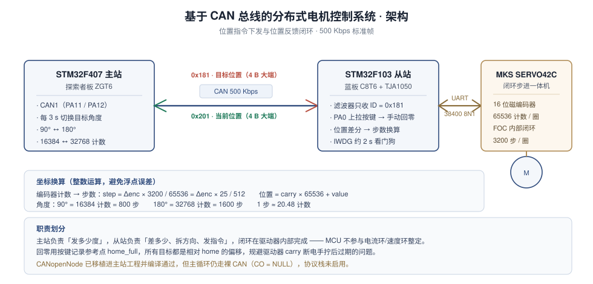

# 基于 CAN 总线的分布式电机控制系统

STM32F407 主站 + STM32F103 从站，通过 CAN 总线（500Kbps）实现**分布式闭环位置伺服**。主站周期下发目标角度，从站驱动 MKS SERVO42C 闭环步进电机，利用其内置 16 位磁编码器与位置模式（0xFD 相对脉冲指令）完成精确绝对定位。

## 系统架构



主站只负责「发目标 + 收状态」，位置闭环在 SERVO42C 内部完成；从站是协议翻译层，把 CAN 上的目标角度翻译成驱动器能懂的相对脉冲指令。这条链路一旦断开，电机停在原地而不是失控——分工边界就画在这里。

> 本项目完成时没有留存实物照片与演示录屏，架构图与协议表是按最终代码重画的。

## 硬件组成

| 节点 | 开发板 | 外设 |
|------|--------|------|
| 主站 | STM32F407 探索者板（ZGT6） | CAN1（PA11/PA12） |
| 从站 | STM32F103 蓝板（C8T6） | CAN1（PA11/PA12）+ TJA1050 CAN 收发器；USART1（PA9/PA10）；PA0 回零按键（上拉输入，按下=低电平） |
| 执行器 | MKS SERVO42C | 闭环步进电机一体机（内置 16 位磁编码器 + FOC 驱动） |

## 目录结构

```
├── STM32F407_Master                 # F407 主站（Keil 工程，含 CANopenNode 源码）
├── STM32F103_Slave                  # F103 从站（Keil 工程）
│   └── Core/Src/
│       ├── main.c                   # 主逻辑：回零 + 绝对定位 + CAN 收发
│       ├── servo42c.c               # SERVO42C 串口驱动（使能/读编码器/相对定位）
│       └── pid.c                    # 增量式 PID（早期速度闭环遗留，当前未接入）
├── docs/
│   ├── 系统设计说明.md               # 三层职责、单位换算、上电时序、状态机、已知限制
│   ├── CAN协议说明.md                # 位时序计算、帧格式、滤波器配置、多节点 ID 规划、CANopen 对象字典
│   ├── 踩坑记录.md                   # 16 条硬约束与踩过的坑
│   ├── 测试记录.md                   # 参数核算 + 已验证行为 + 待补实测项
│   └── images/architecture.svg       # 系统架构图
└── tools/
    └── protocol_selfcheck.py         # 协议自检脚本（不接硬件，参数直接从源码抓）
```

## 文档

| 文档 | 内容 |
|------|------|
| [系统设计说明](docs/系统设计说明.md) | 主站/从站/驱动器三层各管什么，编码器计数→角度→步数怎么换，上电为什么要先回零 |
| [CAN 协议说明](docs/CAN协议说明.md) | 500Kbps 是怎么算出来的、帧格式、滤波器掩码、多节点 ID 规划、CANopen 对象字典与 PDO 映射 |
| [踩坑记录](docs/踩坑记录.md) | CANopenNode 移植 7 条 + SERVO42C 与 CAN 硬约束 8 条 + 工程编码 1 条，按「约束 → 做法 → 原因」组织 |
| [测试记录](docs/测试记录.md) | 能由代码推导的参数与实测数据分开列，未测的明确写「待补」 |

## 离线自检

不接硬件也能跑。参数是脚本从源码里抓出来再算的，不是从文档抄的：

```bash
python tools/protocol_selfcheck.py
```

六组共 69 项检查：

| 组 | 检查什么 |
|---|---|
| 时钟树与位时序 | 解析 `SystemClock_Config` 的 PLL 与 APB1 分频算出 PCLK1，再验算两个节点的 500 Kbps 与采样点 |
| SERVO42C 帧构造 | 拿 `servo42c.h` 的宏当输入组帧，核对帧长与校验和；0xFD 帧必须正好填满 `Servo_SendCommand` 的 `buf[8]` |
| 0x30 应答解析 | 合法帧、校验和错一字节、长度不足三种情况，验证解析结果与丢弃行为 |
| CAN 载荷 | int32 大端打包解包，含 `INT32_MIN` / `INT32_MAX` 边界 |
| 坐标换算 | `25/512` 与 `3200/65536` 等价、90°/180°/360° 步数、截断误差、负差值的方向拆分 |
| 主站节拍 | 按 `main.c` 的 `while(1)` 复现一遍，列出总线上实际发出的前四帧 |

```
[1] 时钟树与 CAN 位时序
  [PASS] 主站 Prescaler                               7
  [PASS] 从站 Prescaler                               6
  [PASS] 主站波特率 (Kbps)                            500
  [PASS] 从站波特率 (Kbps)                            500
[2] SERVO42C 帧构造（38400 8N1，地址 0xE0，和校验）
  [PASS] 相对位置 dir=1 speed=10 step=800 帧长           8
         帧: E0 FD 8A 00 00 03 20 8A
...
通过 69 项，失败 0 项
```

改完 Prescaler 或换算系数先跑这个。两节点波特率不一致这类错误在上位机侧很难看出来——现象是"代码没错、就是收不到"，因为双方各自进了错误帧直到 Bus-Off。

## CAN 通信协议

波特率 **500Kbps**，标准帧（11 位 ID），数据帧，DLC=4。数据均为 **int32 大端**，单位 = 编码器计数。

### 0x181 命令帧（主站 → 从站）

| 字节 | 含义 |
|------|------|
| Byte0~3 | 目标位置（int32 大端）。90° = 16384，180° = 32768 |

### 0x201 反馈帧（从站 → 主站）

| 字节 | 含义 |
|------|------|
| Byte0~3 | 当前编码器位置（int32 大端） |

从站 CAN 滤波器：仅接收 ID = 0x181 的消息（掩码模式，FilterId = 0x181<<5）。

## SERVO42C 串口协议（从站 ↔ 电机）

- 参数：UART **38400/8N1**，地址 **0xE0**，校验 = 所有字节求和取低 8 位。
- 编码器：**16 位协议，65536 计数/圈**（90° = 16384 = 0x4000）。
- 位置 = carry(int32 圈数) × 65536 + value(uint16 圈内计数)。

| 功能码 | 命令 | 说明 |
|--------|------|------|
| 0x82 | 设工作模式 | 0x02 = CR_UART 串口控制模式（默认是脉冲模式，必须切到此模式） |
| 0x85 | 设 EN 引脚 | 0x02 = Hold 一直使能 |
| 0xF3 | 使能电机 | 0x01 = 使能 |
| 0x30 | 读编码器 | 回复 8 字节 `E0 + carry(4B 大端) + value(2B 大端) + CRC` |
| 0xFD | 相对位置 | `E0 FD [dir<<7\|speed] [step 4B 大端] [CRC]` |

- **步距**：3200 步/圈（Mstep=16），1 步 = 65536/3200 = 20.48 计数。
- **换算**：`step = 计数差 × 25 / 512`。
- **方向**：`dir=0` 反转（编码器减小）、`dir=1` 正转（编码器增大）。
- **速度**：speed 值 × 500 步/秒（speed=10 即 5000 步/秒）。

## 核心算法：绝对定位

从站收到目标位置后，用电机自带的相对位置模式做绝对定位（闭环在驱动器内部，MCU 只做位置差分解算）：

```c
encoder_pos = Servo_ReadEncoder();                     // 读当前多圈位置
int32_t delta_enc = (home_full + target_pos) - encoder_pos;  // 目标 - 当前
int32_t delta_step = delta_enc * 25 / 512;             // 编码器计数 → 步数
uint8_t dir = 1;                                       // 拆分方向 + 幅值
if (delta_step < 0) { dir = 0; delta_step = -delta_step; }
Servo_SetPosition(dir, 10, delta_step);                // 发 0xFD 相对位置指令
```

## 回零

上电后从站等待 PA0 按键按下，记录当前位置为参考点 `home_full`，之后所有定位都相对 `home_full`。这样能规避电机断电手拧后圈数（carry）过期的问题——carry 存 EEPROM、只有上电转动才更新。

## 看门狗（IWDG）

从站启用独立看门狗：`PR=4`、`RLR=1249`、LSI 40kHz，超时约 **2 秒**；主循环首行喂狗 `0xAAAA`。防止程序跑飞后电机失控。

## 运行流程

1. 上电，从站等待 PA0 按键（先把输出轴对齐物理 0°，再按下按键）。
2. 主站每 3 秒通过 CAN 切换目标位置 90°（16384）↔ 180°（32768）。
3. 从站收到目标，算差值 → 发 0xFD 相对位置指令，电机精确定位。
4. 从站每 50ms 通过 CAN 回传当前编码器位置。

> 一个细节：总线上**第一帧实际是 180°**（t≈3.05 s），因为 `master_target` 的初值 16384 在第一次判断时先被翻成 32768 再发送，初值本身没有上过总线。时序模拟见自检脚本第 6 组。

## 待扩展

- **CANopenNode**：已移植进 F407 主站工程（编译通过），当前主循环走裸 CAN、协议栈未启用（`CO=NULL`），可扩展为 CANopen 从站。
- **自动回零**：当前为按键手动回零，可升级为限位开关自动回零。
- **多节点**：增加第二从节点，强化「分布式」卖点。
