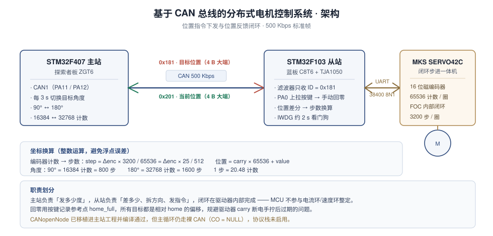

# 系统设计说明



> 目标：主站下发角度，从站驱动电机精确到位，并把当前位置回传。
> 分工原则：**主站只决定"去哪"，从站负责"差多少"，闭环交给驱动器。** MCU 不参与电流环/速度环整定。

---

## 一、三层职责划分

| 层级 | 器件 | 职责 | 实时性要求 |
|---|---|---|---|
| 调度层 | STM32F407 主站 | 决定目标角度、按周期下发、收集位置 | 低（秒级） |
| 协议/解算层 | STM32F103 从站 | 收 CAN 帧、读编码器、算差值、换算步数、发串口指令 | 中（毫秒级） |
| 执行层 | MKS SERVO42C | FOC 电流环 + 速度环 + 位置环，16 位磁编码器反馈 | 高（驱动器内部硬件闭环） |

这样划分的直接好处：**位置环不需要在 MCU 上实现**。MCU 只需要发"再走 N 步、往哪个方向、多快"，剩下由驱动器自己收敛。早期写的 `pid.c`（增量式位置环）因此没有接入主流程。

---

## 二、坐标系与换算

三套单位必须能互相换算，否则动一下角度就错：

| 单位 | 量纲 | 一圈对应 |
|---|---|---|
| 编码器计数 | 16 位磁编码器 | **65536** 计数/圈 |
| 电机步数 | 驱动器细分（Mstep = 16） | **3200** 步/圈 |
| 机械角度 | 度 | 360° |

**步数与计数的换算**（整数运算，避免浮点误差）：

```
1 步 = 65536 / 3200 = 20.48 计数
step = Δenc × 3200 / 65536 = Δenc × 25 / 512
```

`3200/65536` 约分正好是 `25/512`，所以代码里直接写 `delta_step = delta_enc * 25 / 512`，全程 int32 不出现小数点。

**角度对照**：

| 角度 | 编码器计数 | 步数 |
|---|---|---|
| 90° | 16384 | 800 |
| 180° | 32768 | 1600 |

**多圈位置**：驱动器返回的是 `carry`（圈数，int32）+ `value`（圈内计数，uint16），

```
position = carry × 65536 + value
```

---

## 三、上电时序

```
上电
 └─ HAL_Init / 时钟 / GPIO / CAN / USART1 初始化
 └─ CAN 滤波器配置 → HAL_CAN_Start → 开 RX FIFO0 中断
 └─ HAL_Delay(2000)                        ← 等 SERVO42C 自身启动完成
 └─ Servo_Enable()
      ├─ 0x82 = 0x02   切到 CR_UART 串口控制模式，等 2 s
      ├─ 0x85 = 0x02   EN 引脚设为 Hold（一直使能），等 500 ms
      └─ 0xF3 = 0x01   电机使能，等 500 ms
 └─ 等待 PA0 按键（上拉输入，按下为低电平）
 └─ 消抖 50 ms → 读编码器 → 记 home_full → new_target_flag = 1
 └─ 启动 IWDG（PR=4，RLR=1249，约 2 s）
 └─ 进入主循环
```

> **每一步都做了两件事**：清空 UART 接收缓冲 + 等固定延时。前者防止上一条指令的应答被当成新帧，后者给驱动器留出机械动作/模式切换时间。这两个细节决定了这套串口协议能不能稳定跑。

---

## 四、运行循环

### 主站（F407）

```c
while (1) {
    if (HAL_GetTick() - last_switch > 3000) {      // 每 3 秒
        last_switch = HAL_GetTick();
        master_target = (master_target == 16384) ? 32768 : 16384;
        // 4 字节大端打包 → ID 0x181 发一帧
    }
    HAL_Delay(50);
}
```

**为什么是"每 3 秒发一次"而不是周期连发**：从站收到目标后要等电机转到位（约 500 ms）。若主站高频重发，从站会在运动中途被新目标打断，表现为"走一半又折返"。改成事件式单发后，动作干净。

### 从站（F103）

```c
while (1) {
    IWDG->KR = 0xAAAA;                     // 喂狗
    if (new_target_flag) {
        new_target_flag = 0;
        encoder_pos = Servo_ReadEncoder();                    // 读当前位置
        int32_t delta_enc  = (home_full + target_pos) - encoder_pos;
        int32_t delta_step = delta_enc * 25 / 512;            // 计数 → 步数
        uint8_t dir = 1;
        if (delta_step < 0) { dir = 0; delta_step = -delta_step; }   // 拆方向 + 幅值
        Servo_SetPosition(dir, 10, delta_step);               // 0xFD 相对位置
        HAL_Delay(500);                                        // 等电机转完
    }
    // 每 50 ms 回传一次当前编码器位置（ID 0x201）
    HAL_Delay(50);
}
```

关键点：**方向与幅值必须分开传**。0xFD 指令里 `dir` 占 bit7、`speed` 占低 7 位，`step` 是独立的 4 字节无符号量——所以负数差值要先取绝对值、再把方向写进 bit7，不能直接发负数。

---

## 五、回零的设计原因

SERVO42C 的 `carry`（圈数）存在驱动器 EEPROM 里，**只有在通电状态下转动才会更新**。如果断电后用手拧过电机，`carry` 就是过期的，此时读到的"绝对位置"是错的。

解决方案不是去修 `carry`，而是**绕开它**：

1. 上电后等人工把输出轴对齐到物理 0°，按下 PA0；
2. 记录此刻的 `home_full` 作为参考点；
3. 之后所有目标位置都表示成**相对 `home_full` 的偏移**。

这样即使 `carry` 漂移，只要每次上电都重新回零，"目标 → 当前"的差值依然正确。

---

## 六、状态机

```
BOOT ──▶ SERVO_INIT ──▶ WAIT_HOME ──▶ RUN
         (切模式/使能)    (等 PA0)      (定位循环)
                             │
                             └─ 未回零前不接受目标：避免在参考点未知的情况下运动
```

`RUN` 状态内部是一个事件驱动的小循环：**CAN 中断置标志 → 主循环处理 → 回传位置**。中断里只做解析和置位，不做耗时动作（读编码器要等串口，绝不能放在中断里）。

---

## 七、已知限制

以下都是当前实现的真实边界，不做美化：

| 限制 | 原因 | 可改进方向 |
|---|---|---|
| 单从节点 | 命令 ID 固定 `0x181`、反馈固定 `0x201`（对应 CANopen NodeID=1）。同一条总线再加从站会撞 ID | 按 NodeID 分配 ID（`0x180+ID` / `0x200+ID`），或启用 CANopenNode 用 SDO 配置 |
| 总线错误不自动恢复 | CAN 初始化时 `AutoRetransmission = DISABLE`、`AutoBusOff = DISABLE` | 打开自动重传与自动离线恢复 |
| 到位判断靠固定延时 | `HAL_Delay(500)` 等电机转完，未读编码器确认 | 轮询编码器，差值小于阈值即认为到位（可省掉固定等待） |
| 定位期间不回传位置 | 主循环被 `HAL_Delay(500)` 阻塞 | 改定时器/中断驱动回传，或把定位放到独立状态 |
| 无急停与限位 | 仅软件回零 | 加硬件限位开关 + 急停按钮，串口侧支持 `Servo_Stop()` |
| `pid.c` 未接入 | 位置环已由驱动器承担，MCU 侧 PID 冗余 | 若换普通步进/直流电机则启用 |
| CANopenNode 未启用 | 已移植编译通过，主循环仍走裸 CAN（`CO = NULL`） | 见 `docs/CAN协议说明.md` 的对象字典与 PDO 配置 |

---

*相关文档：[CAN协议说明.md](CAN协议说明.md)（帧格式与滤波器）· [踩坑记录.md](踩坑记录.md) · [测试记录.md](测试记录.md)*
